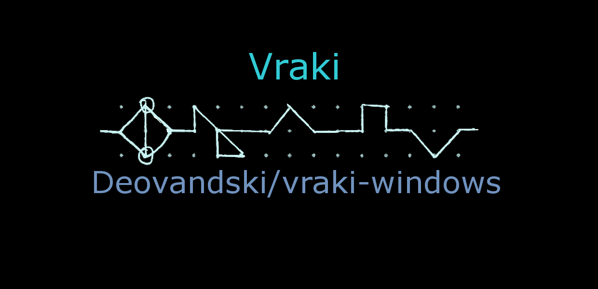

# Privacy

## The Vraki Language app (2017)

No personal information is used or stored by this app, other than any information handled by Microsoft to keep the app working and for crash analysis. The text you convert stays on your device.

## The website

The website at https://deovandski.github.io/vraki-windows/ has no cookies, no analytics and no ads. The converter and the typeface preview run entirely in your browser; nothing you type is sent anywhere. The site is hosted on GitHub Pages, so [GitHub](https://docs.github.com/site-policy/privacy-policies/github-general-privacy-statement) sees your IP address when it sends you the page.

Questions: open an [issue](https://github.com/Deovandski/vraki-windows/issues).

Copyright (c) 2017, Deovandski Skibinski Junior.
