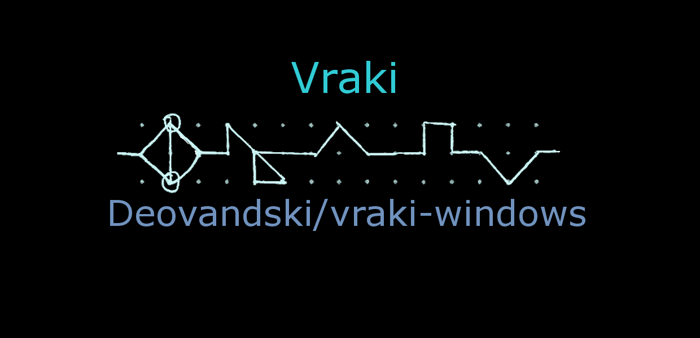
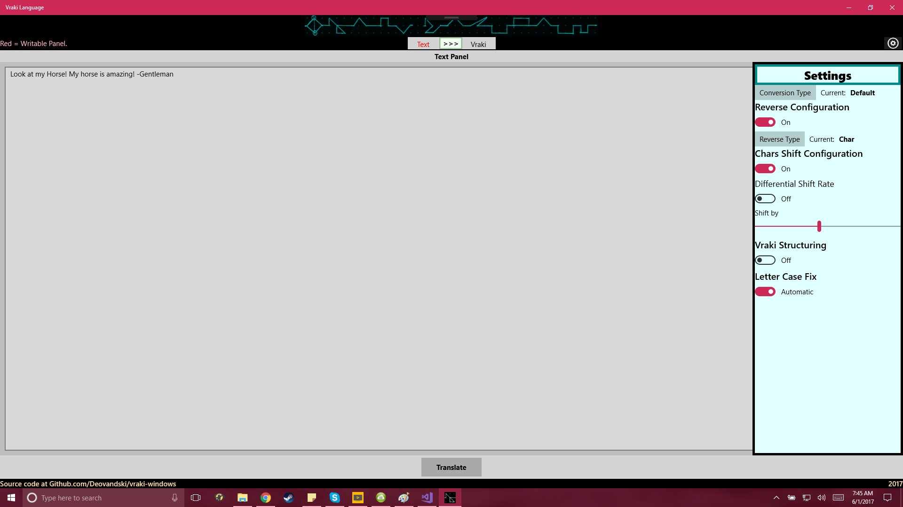
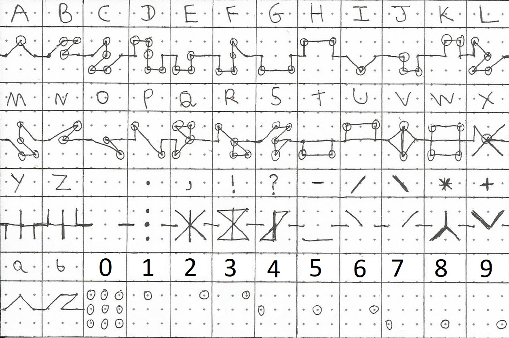

# Vraki Language for Windows

<p align="center">
  
</p>

> **Originally from 2017, resurrected for historical purposes.**
> The app in [`legacy/`](legacy/) is the Universal Windows Platform app published on the Microsoft Store in 2017. Its C# and XAML are unchanged; it lives here as a record of where Vraki started.

Vraki began as this small Windows app that reversed, shifted and restructured English until it read like a new language. It went on to become the writing of the [#HusbandOutWorld](https://github.com/Deovandski/HusbandOutWorld) series, with its own [typeface](#the-vraki-typeface), written **1:1 with English**. Modernizing the app around that idea is the next step for this repository.

**Website:** https://deovandski.github.io/vraki-windows/ · **Microsoft Store:** [Vraki Language](https://apps.microsoft.com/detail/9P41XHS4HMLX) · **Source download:** [latest release](https://github.com/Deovandski/vraki-windows/releases/latest)

<p align="center">
  
</p>

## Where Vraki came from

Deovandski always dreamed of coming up with a language. As a child he doodled the alphabets of alien civilizations, and the more he traveled the world and soaked up its cultures, the closer those doodles drifted to the Vraki writing you see here.

He didn't expect it to grow into an entire world with extensive lore, and from there into several stories:

- **[A Husband Out of This World](https://github.com/Deovandski/HusbandOutWorld)**, published as the **#HusbandOutWorld** light novel series. It opens on Paulin 14th, 1039 A.G. (After Ganyrami, the Vraki calendar's count from the year Ganyrami fell), when Harry is summoned out of our world into the world of Vraki, in the Prosperity Treaty era, the long peace that followed the overthrow of the old kingdoms.
- **[Vraki West March Campaign](https://github.com/Deovandski/Vraki-West-March-Campaign-D-D)**, an open-table, West Marches-style D&D 5e campaign set in the same world in the 1040s A.G., with lore summaries, quests, stat blocks and ready-made adventurers.

This app is where the writing first went digital, back in 2017.

## What the 2017 app does

- **Two panels.** Type English in the Text panel, press **Translate**, and read the result in the Vraki panel. Flip the `>>>` switch to convert back.
- **Four conversion types.** *Default*, *Simple Vraki*, *Complex Vraki* and *Minimal*, or mix your own (*Custom*).
- **Building blocks you can toggle:** five kinds of reverse (char, word, word pair, and combinations), alphabet shift (optionally at different rates for consonants and vowels), the *Vraki structure* that turns letter pairs like `rs` into `l-li`ld`, and an automatic letter case fix.

| Conversion type | "Look at my Horse! My horse is amazing! -Gentleman" becomes |
|---|---|
| Default | `Kxjbiqkbd- !Dkfwxjx pf bpole vj !Bpole vj qx hlli` |
| Simple Vraki | ``Look at my hol-li`lde! My hol-li`lde is amazing! -Gentleman`` |
| Complex Vraki | ``Tbi-rg`ldbzhoy- !Itzbiun ug voagf zm !Voagf zm ih yxaa`` |
| Minimal | `Mppl bu nz ipstf! Nz ipstf jt bnbajoh! -Hfoumfnbo` |

How every step works, with the original 2017 diagrams: **[docs/ALGORITHMS.md](docs/ALGORITHMS.md)**.

**Try it without Windows:** the [website](https://deovandski.github.io/vraki-windows/#try) runs a line-by-line JavaScript port of the 2017 code, checked against the app's own output (`node tools/test-vraki-2017.js`).

## Version history (2017)

| Version | Changes |
|---|---|
| 1.4 | Fixed issues #2 and #3. |
| 1.3 | Changed the header image to support VisualStates, and updated the GitHub links. |
| 1.2 | Changed how the current panel and the writable panel are shown. |
| 1.1 | May 2017. The only built package that survived is this version: it's attached to the [v1.4.0-legacy release](https://github.com/Deovandski/vraki-windows/releases) for the record. Its certificate expired in 2018, so install from the Store instead. |

## The Vraki typeface

The 2017 README ended with a sketch and a promise to turn it into a font "if time allows". That font now exists: **Vraki - #HusbandOutWorld Series**, made for the series.

<p align="center">
  
</p>

- **Where:** [Deovandski/HusbandOutWorld › Logo and Font](https://github.com/Deovandski/HusbandOutWorld/tree/main/Logo%20and%20Font) has `VrakiHusbandOutWorldSeries-Rg` as `.otf`, `.ttf` and `.woff2`, and the hand-drawn reference sheet `Vraki TypeFace - v2.png`.
- **How it works:** one glyph per English letter, A to Z, drawn as a line across a dotted grid. Upper case letters carry small circle markers; lower case is the same stroke without them. Digits mark one dot on a 3×3 grid, and punctuation has its own marks. Type English in the font and it's written in Vraki.
- **Lore:** [World Lore › Language](https://github.com/Deovandski/HusbandOutWorld/blob/main/World%20Lore/Language.md) describes Vraki as the common language inherited from the Finaies: mostly English, with a skin.
- **License:** the typeface is © 2024 Deovandski Skibinski Junior ([font license](site/fonts/LICENSE.md)). Non-commercial use is free with attribution. Commercial use needs approval and a fee, kept small for artists and creators to support the community; ask through [the official channels](https://husbandoutworld.com/). It may not be altered without permission. The website includes an unaltered copy only to render Vraki text (see [site/fonts/README.md](site/fonts/README.md)). The rest of the HusbandOutWorld repository is CC BY-NC-SA 4.0.

## Install

Get **[Vraki Language from the Microsoft Store](https://apps.microsoft.com/detail/9P41XHS4HMLX)** (or open `ms-windows-store://pdp/?productid=9P41XHS4HMLX` on Windows). It's the 2017 app, version 1.4.

## Build from source

The 2017 project needs Visual Studio with the **Universal Windows Platform development** workload. Open `legacy/Vraki Language.sln` and press **F5**. Details, SDK versions and caveats: [legacy/README.md](legacy/README.md).

```
legacy/                  the 2017 UWP app, unchanged (solution, C#, XAML, assets)
docs/ALGORITHMS.md       how the conversions work, with the 2017 diagrams
docs/2017-design/        original design files: GIMP sources, tables, handwritten notes
docs/media/              diagrams and screenshots from 2017
docs/STORE.md            the Store listing, and keeping its identity out of git
packaging/               store-identity.example.json (the real one is git-ignored)
site/                    GitHub Pages website, with the JavaScript port of the converter
tools/                   tests for the port
```

Docs: [How the conversions work](docs/ALGORITHMS.md) · [Microsoft Store](docs/STORE.md) · [Releasing](docs/RELEASING.md) · [Privacy](PRIVACY.md) · [Security](SECURITY.md)

## Store identity

Like [Deo's LED Matrix Manager](https://github.com/Deovandski/Deo-s-Framework16-LED-Matrix-Manager), the Microsoft Store identity stays out of git: the committed manifest uses a development identity, the real values go in the ignored `packaging/store-identity.json`, and signing keys and Store packages are ignored too. CI fails if the committed manifest ever carries anything but the development identity. See [docs/STORE.md](docs/STORE.md).

## Disclosure

**History.** The code in `legacy/` is version 1.4 of the 2017 app and was first published on GitHub that year. In 2026 it was moved into `legacy/` with its manifest identity neutralized; nothing else in it was changed.

**AI assistance.** The 2026 restoration (repository layout, website, JavaScript port, docs and workflows) was done with help from Claude (Anthropic). Commits it contributed to are marked `Co-Authored-By: Claude`. The 2017 code is entirely the original.

## License

[MIT](LICENSE) © 2017 Deovandski Skibinski Junior. The Vraki typeface in `site/fonts/` is not covered by the MIT license; it has [its own license](site/fonts/LICENSE.md).
