# How the 2017 app converts text

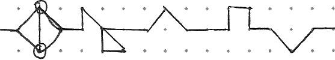

This is the original 2017 write-up from the app's README, kept as it was written (image paths updated). The code it describes is in [`legacy/Vraki Language/MainPage.xaml.cs`](../legacy/Vraki%20Language/MainPage.xaml.cs), and a line-by-line JavaScript port runs on the [website](https://deovandski.github.io/vraki-windows/#try).

> The 2017 app treated Vraki as a cipher: reverse, shift and restructure English text until it looks like a new language. The modern direction is different: Vraki is written 1:1 with English, letter for letter, in the [Vraki typeface](https://github.com/Deovandski/HusbandOutWorld/tree/main/Logo%20and%20Font). See the [README](../README.md#the-vraki-typeface).

## Conversion Types

Below is a quick summary of each conversion type available on the App. If you would like to add one to the store app, then either create an issue with the details or create a pull request.

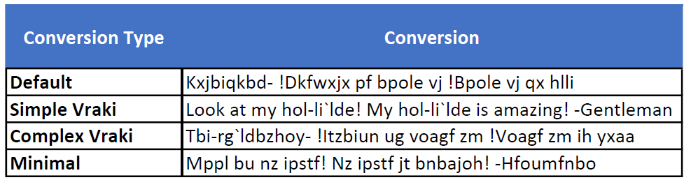

#### Default
1. Char Reversal
2. All Shift by -3
3. Automatic Letter Case Fix

#### Simple Vraki
1. Vraki Structure Conversion
2. Automatic Letter Case Fix

#### Complex Vraki
1. Char + Word Pair Reversal
2. Consonant Shift by -10
3. Vowel Shift by 2
4. Vraki Structure Conversion
5. Automatic Letter Case Fix

#### Minimal
1. All Shift by +1 *(the 2017 README said -1; the code and the app's output shift by +1)*
2. Automatic Letter Case Fix

## Components

Below is the breakdown of all components in which you may interact to alter how a given text is translated.

Converting to Vraki runs them in this order: Reverse, Shift, Vraki Structure, Letter Case Fix. Converting back runs Vraki Structure, Shift, Reverse, then Letter Case Fix. All text is lowercased first.

### Reverse

Below is a quick summary of each reverse type.

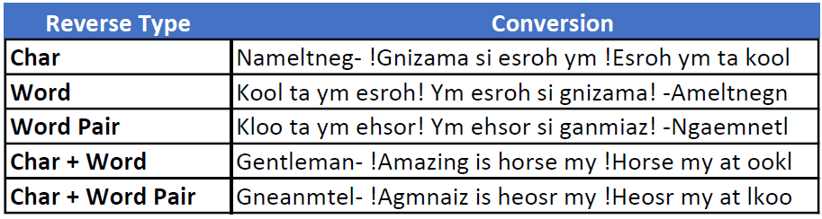

#### Char Reverse

Your average reverse algorithm where the entire text is reversed.

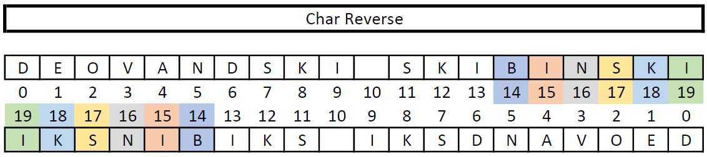

#### Word Reverse

Same as Char Reversal, but the reversal happens across the boundaries of a word. This is achieved by adding chars of the String text to be reversed to a temp List<Char> until a word break is found. When this happens, the temp list is reversed and dumped in the reversed List<Char> followed by continuing the loop iteration until the end of the text is reached.

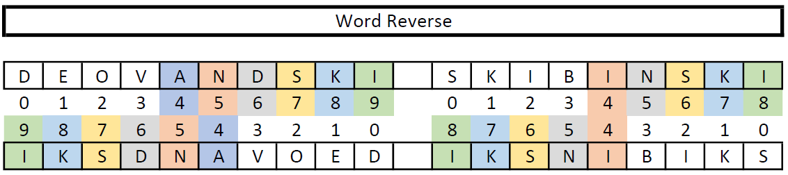

#### Word Pair Reverse

Same structure as the Word Reverse Algorithm, but the temp List<Char> is not just simply reversed. Instead, a separate encryption/Decryption occurs as followed:

##### Encryption

For words with even char length, you pick each char on the outermost part of the word alternating from each side starting from the left.

For odd words, you find the median char and put it to the side followed by the same process of even char length. Then, re-attach the median char to the end of the converted word.

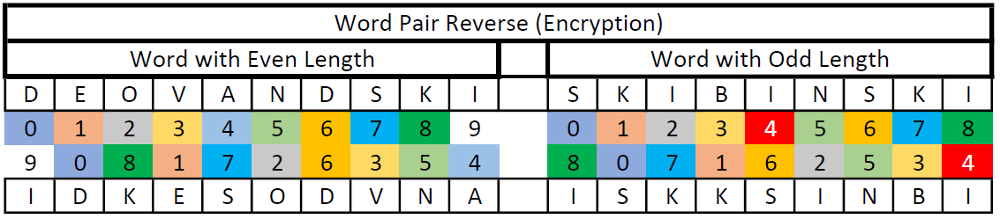

##### Decryption

For words with even char length, you select every odd char from left to right followed by every even from right to left.

If the word is odd, then take out last char to the side followed by selecting every odd char from left to right. Then, you add the char stored aside to your decrypted List<Char> or append to a String followed by adding every even from right to left.

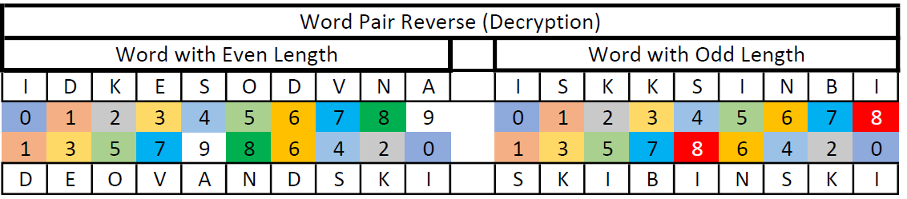

#### Char + Word Reverse

This is a combination of two reversal algorithms. Encryption for this component is passing the text through Char reversal followed by Word reverse. Decryption is the opposite.

#### Char + Word Pair Reverse

Same as previous, but replace Word with Word Pair reverse algorithm.

### Shift

The usual shift the alphabet by x amount of characters, but Vraki Language also have the option to shift consonants and vowels at different rates.

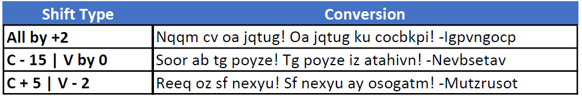

### Vraki Structure

A component that replaces pairs of specific chars into a longer text which makes up the Vraki Language structure. An example is hf > c-rn`ld.

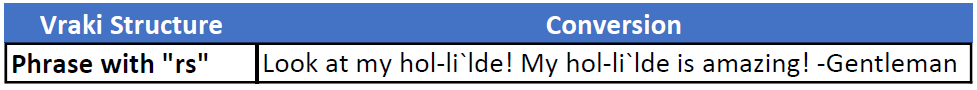

The full table from the code:

| Pair | Becomes | Pair | Becomes | Pair | Becomes |
|---|---|---|---|---|---|
| hf | c-rn\`ld | la | s-or\`ld | tu | u-dx\`ld |
| fs | a-ew\`ld | uf | s-eh\`ld | yn | t-is\`ld |
| eb | h-tk\`ld | im | n-aj\`ld | id | e-ra\`ld |
| uk | s-dc\`ld | ud | o-ek\`ld | ne | a-it\`ld |
| od | s-er\`ld | sv | s-lc\`ld | au | c-kj\`ld |
| fn | a-ts\`ld | da | e-om\`ld | rs | l-li\`ld |
| kh | e-mi\`ld | oi | i-rg\`ld | ie | r-mi\`ld |
| rt | t-nx\`ld | | | | |

### Letter Case Fix

This component focuses on maintaining Upper Case structure after conversions are done. Basically, it searches for word breaks in which an upper case char follows, and make them so. Also, quotes from someone in which the person's name appears as "lorem ipsum -abc" will have the 'a' turned into its Upper Case match.

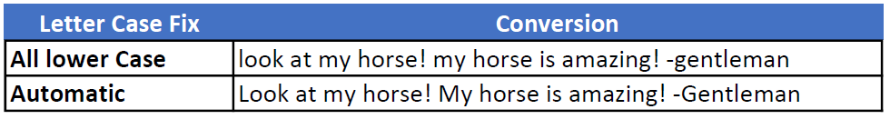

## Known quirks (kept on purpose)

The website's port reproduces the 2017 behavior exactly, including these:

- The last character of the text always joins the last word in Word and Word Pair reverse, so the final word doesn't always convert back cleanly.
- In Word Pair reverse, a one-letter word gets merged into the next word ("i am" comes back as " iam").
- Converting back assumes the same settings were used to convert; the app didn't store them.
- In a few short or end-of-text cases the 2017 Letter Case Fix read past the end of the text and the app crashed. The website's port stops there instead.

## Font

The 2017 README ended with this sketch: *"This is the overall idea of how I think the Vraki font will look like. If time allows, I will develop a cleaner version of the following drawing followed by a font in which you can use it alongside the app."*

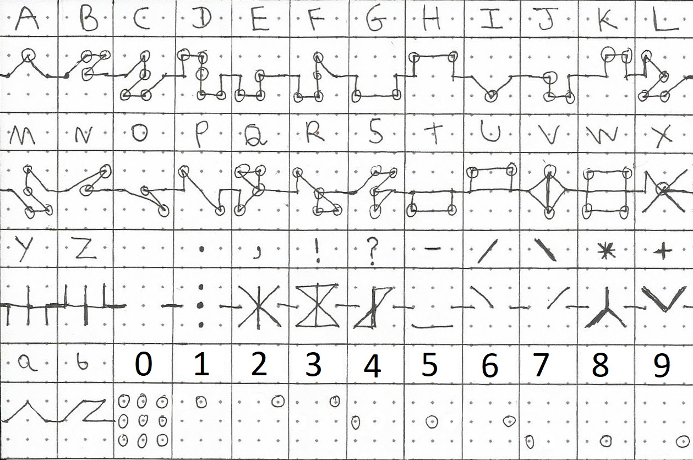

That font now exists: see [the Vraki typeface](../README.md#the-vraki-typeface).
