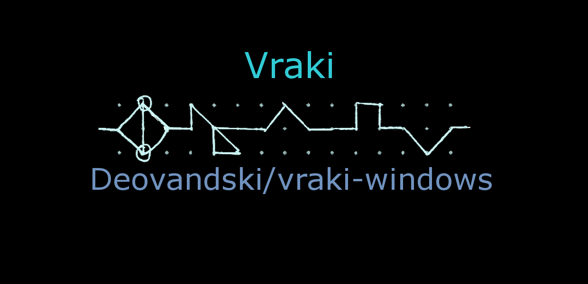

# Vraki Language for Windows (2017)

This folder is the original **Universal Windows Platform (UWP)** app from 2017, the one published on the [Microsoft Store](https://apps.microsoft.com/detail/9P41XHS4HMLX). It's kept as it was, for historical purposes.

What changed when it was moved here in 2026:

- The folder moved from `Vraki Language/` to `legacy/`.
- `Package.appxmanifest` uses a neutral development identity instead of the 2017 one (see [docs/STORE.md](../docs/STORE.md)).

The C# and XAML are untouched.

## What's inside

| File | What it is |
|---|---|
| `Vraki Language.sln` | Visual Studio 2017 solution |
| `Vraki Language/MainPage.xaml` | The whole UI: Text and Vraki panels, the Settings pane, the Translate button |
| `Vraki Language/MainPage.xaml.cs` | Every conversion algorithm (reverse, shift, Vraki structure, letter case) and the UI logic |
| `Vraki Language/App.xaml(.cs)` | Standard UWP app startup |
| `Vraki Language/Assets/` | Tiles, splash screen and title art |
| `Vraki Language/Package.appxmanifest` | App manifest (development identity) |

How the conversions work: [docs/ALGORITHMS.md](../docs/ALGORITHMS.md).

## Opening it today

It targets Windows 10 SDK **10.0.18362** and `Microsoft.NETCore.UniversalWindowsPlatform` 5.2.4.

1. Install Visual Studio 2022 with the **Universal Windows Platform development** workload, and the **Windows 10 SDK (10.0.18362.0)** from *Individual components* (or retarget the project to an SDK you have when Visual Studio asks).
2. Open `legacy/Vraki Language.sln`.
3. Pick **Debug | x64** and press **F5**. Visual Studio creates a temporary signing key (`*_TemporaryKey.pfx`, ignored by git) and deploys the app locally. Windows needs **Developer Mode** on.

It's a classic UWP project built with .NET Native, so it needs the UWP workload; if your Visual Studio doesn't offer that workload, use Visual Studio 2022. This hasn't been re-tested since the move. If you only want to try the conversions, the [website](https://deovandski.github.io/vraki-windows/#try) runs a line-by-line port of this code in the browser.
